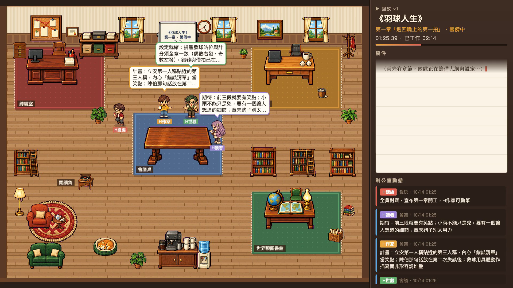
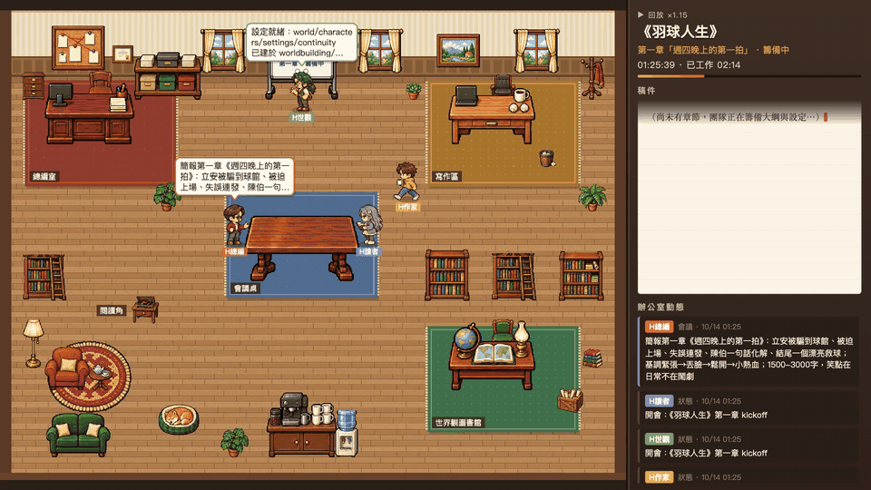

# AI Novel Office

A cosy pixel-art office that shows a Claude Code agent team writing a novel. Four roles (H總編 editor-in-chief,
H作家 writer, H世觀 worldbuilder, H讀者 reader/critic) walk to each other's desks to talk, gather at the meeting
table, stamp decisions, fetch references from the shelves, fly finished pages to the manuscript shelf and celebrate
approved chapters, while a side panel types out the chapter as it is written.





Full time-lapse of the team writing 《羽球人生》 chapter 1 (about 2 minutes):
[1080p60](docs/media/office-timelapse.mp4) · [720p web copy](docs/media/office-timelapse-web.mp4)

## How it works

The team appends everything it does to `logs/activity.jsonl`, one JSON object per line:

```json
{"timestamp":"2026-10-14T01:25:39+08:00","agent":"H總編","type":"meeting","content":"...","to":"全員","novel":"badminton-life"}
```

`type` is `task | message | status | decision | meeting`; statuses are `working`, `idle` or `meeting — <topic>`;
file writes are logged as `task` events with content `檔案更新: <file>`.

| Event | Animation |
|---|---|
| `status` `working` | walk to own desk, type, thought bubble with the task |
| `message` to someone | walk next to them and talk; they turn to listen |
| `message` to everyone | announce in front of the whiteboard |
| `meeting` | everyone gathers at the meeting table, speakers take turns |
| `decision` | the editor stamps it |
| `檔案更新: <file>` | a page flies to the manuscript shelf, the library or the whiteboard |
| `查閱: <file>` (imported) | walk to the shelf / library / whiteboard and read |
| new chapter, final approval | the writer cheers; everyone celebrates with confetti |
| between events | keep typing, fetch references, get coffee, pet the office shiba |

`src/core/director.ts` turns each event into character actions (a pure, unit-tested function); `src/core/world.ts`
executes them headlessly (8-direction A* around furniture, depth-sorted, never teleporting); the Phaser scene only draws.

## Run

The app expects to live in a project folder next to `logs/activity.jsonl` and `novels/<slug>/` (chapters, reviews,
worldbuilding, and `novels/registry.md` for titles).

```bash
cd office
npm install
npm run dev            # http://localhost:5188
```

| URL | Mode |
|-----|------|
| `/` | **Live**: tails `logs/activity.jsonl` over server-sent events and follows whichever novel the team is working on. |
| `/?replay=badminton-life` | **Replay**: a time-lapse of one novel's run. Real time is compressed so the whole run lasts about 80-120 s (`&target=60` to change it, `&speed=2` to double it). Long waits are squashed, order is kept, and between events the team keeps working so the office never looks idle. The panel and the wall clock show the run's real time. Deterministic. |
| `/?demo` | **Demo**: replay of the newest novel (or `&replay=<slug>`) with the clock stopped; `window.__demo.advance(n)` steps n frames of 1/60 s for frame-perfect recording. |

```bash
npm test               # vitest: director, pacing, transcript import, pathfinding, bubbles, replay determinism
npm run build          # static build in dist/ (replays only: live mode needs the dev server)
node art/record.mjs    # frame-stepped 60 fps capture of the newest replay -> art/rec/<slug>.mp4 (needs ffmpeg)
```

## Richer replays from a run transcript

`activity.jsonl` holds what the team reported. If the team ran headless (`claude -p --output-format stream-json`),
the transcript also shows which files each role read and wrote, and when. Import it once:

```bash
npm run import -- badminton-life --transcript /path/to/run.jsonl   # writes data/derived/badminton-life.jsonl
npm run import -- badminton-life --transcript run.jsonl --log ../old-project/logs/activity.jsonl
```

`--log` carries over that novel's events from another activity log (e.g. a chapter written before the project moved).
The derived file uses the same schema (file names only, no paths or prompts) and is merged into that novel's replay
by time: reads become walks to the shelves, writes become pages flying to the manuscript shelf. Bursts of saves to the
same file (one role, within 15 s) are shown as a single action.

## Art

Characters and furniture were generated with Codex image generation (`art/gen.mjs`, prompts in `art/roster.json`)
and cut into frames by `art/process.py`: one crop box per sheet and per-row foot anchors, so animations do not jitter.
Raw sheets are not committed; to regenerate run `node art/gen.mjs`, then
`uv run --with pillow --with numpy --with scipy python art/process.py`.
